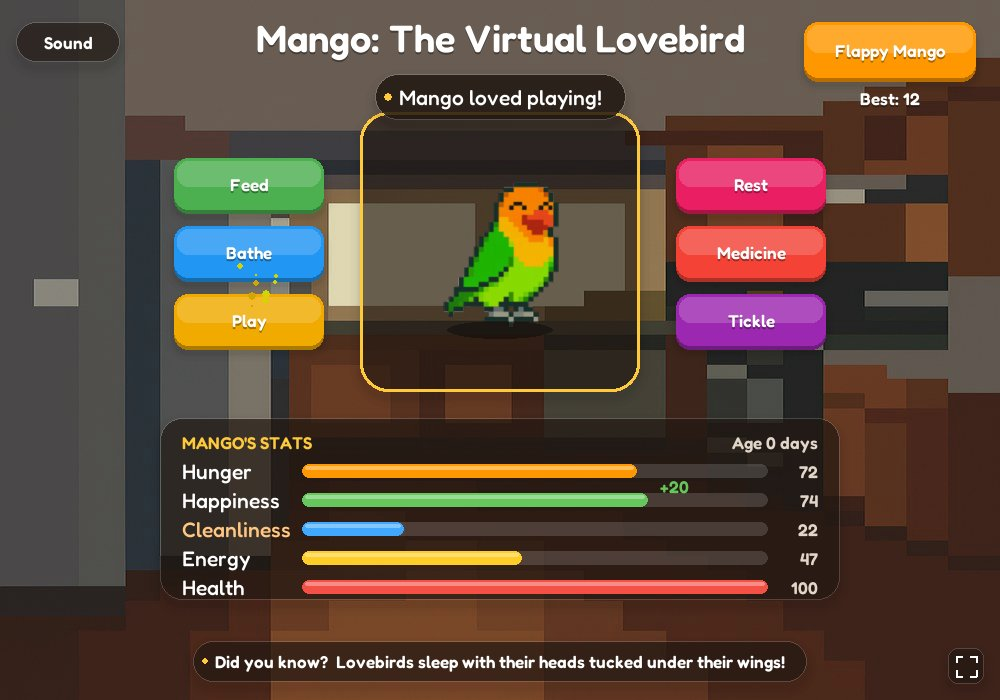
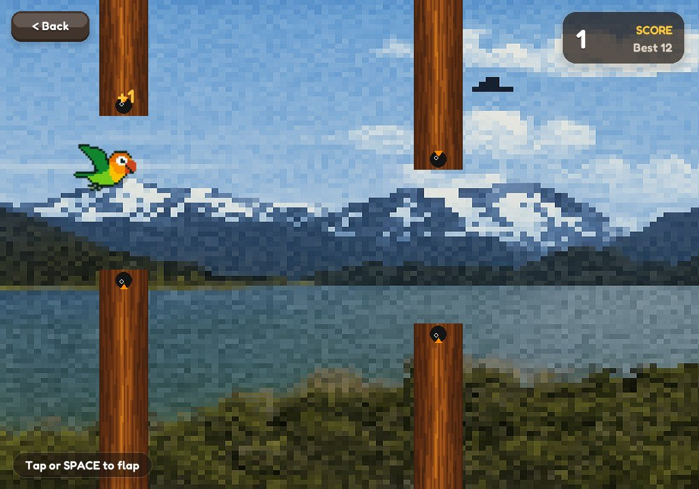
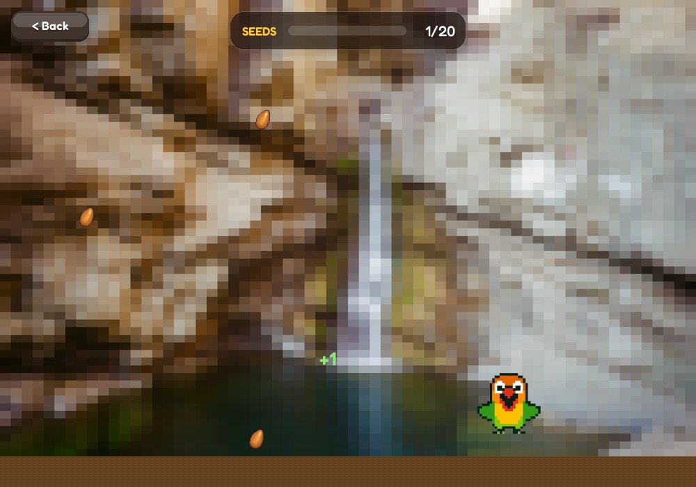
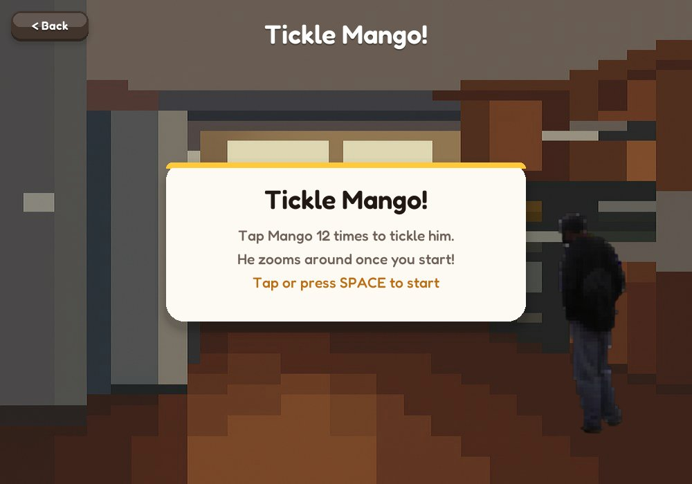
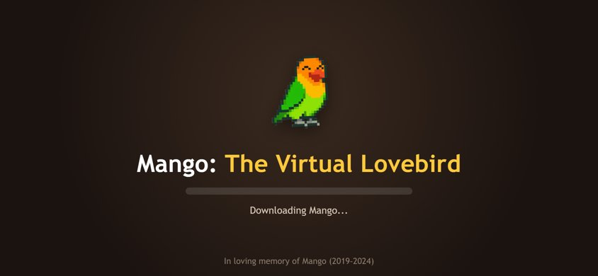

# Mango: The Virtual Lovebird

[](https://github.com/manofmanana/Virtual-Lovebird-Simulator/actions/workflows/deploy.yml)

### ▶ [Play it in your browser](https://manofmanana.github.io/Virtual-Lovebird-Simulator/)

A Tamagotchi-inspired virtual pet game starring Mango, my lovebird, with three mini-games. Built with Python and pygame as my final project for **CS50's Introduction to Programming with Python** at Harvard, and now playable on the web (phones included).

This repository and the game are dedicated in loving memory of my pet love bird Mango (2019–2024). Mango was too beautiful for this world. He was more than a pet — he was my friend and a member of my family. I miss him deeply. May he be flying among the stars.

**Video demo:** https://youtu.be/meBtnLEW4wc

| Mango's room | Flappy Mango |
|---|---|
|  |  |

| Feed | Tickle |
|---|---|
|  |  |

---

## How to play

Keep Mango healthy and happy. His **hunger, happiness, cleanliness, and energy** slowly drop over time, and if any of them gets too low, his **health** starts to fall. If his health reaches zero, Mango flies away.

| Button | What it does |
|---|---|
| **Feed** | Starts the Feed mini-game; catch 20 seeds to fill Mango up (they fall faster the fuller he gets, and misses cost a point) |
| **Bathe** | +30 cleanliness, +10 happiness |
| **Play** | +20 happiness, costs 15 energy (Mango needs some energy left) |
| **Rest** | +30 energy |
| **Medicine** | Heals Mango completely and lifts any very low stats |
| **Tickle** | Starts the Tickle mini-game; makes Mango happier and calms him down if he's been misbehaving |
| **Flappy Mango** | Fly through the gaps between the crows' trees; good runs make Mango happier |

Every couple of minutes something random can happen: Mango might get sick or start misbehaving. He also has a birthday every 24 hours, and the sky changes between day and night with your clock.

**Controls:** everything works with a mouse or a finger. On a keyboard, SPACE starts and flaps, the arrow keys move Mango in Feed, R plays again, and ESC goes back to the hub. On the desktop, F11 toggles fullscreen.

Your progress is saved automatically: in a small SQLite database on the desktop, and in your browser's local storage on the web.

### Playing on a phone

Turn your phone sideways for the biggest Mango. The first visit downloads about 12 MB (mostly the Python runtime that pygbag runs in the browser) and takes a little while to start on slower phones; after that everything is cached, so the game also works offline. In your browser's menu, **Add to Home Screen** installs Mango like an app that opens full screen.



## Run it on your computer

```bash
git clone https://github.com/manofmanana/Virtual-Lovebird-Simulator.git
cd Virtual-Lovebird-Simulator
python -m venv .venv
source .venv/bin/activate          # Windows: .venv\Scripts\activate
pip install -r requirements.txt
python project.py
```

## Build the browser version

The web version is made with [pygbag](https://github.com/pygame-web/pygbag), which runs Python and pygame as WebAssembly.

```bash
pip install -r requirements-dev.txt
python build_web.py --serve        # then open http://localhost:8000
```

`python build_web.py` on its own just builds into `build/mango/build/web`. You don't normally need to: every push to `main` runs the tests, builds the game, and publishes it to GitHub Pages automatically (see `.github/workflows/deploy.yml`).

### Why it didn't work in the browser before

Two things stop most pygame games from running under pygbag, and this one had both:

1. **Every loop has to pause for the browser.** A browser tab runs your Python on the same thread as the page itself, so a `while True` loop that never lets go freezes everything. The main loop already did `await asyncio.sleep(0)` each frame, but each mini-game ran its own loop that didn't. Now there's one `next_frame()` helper that every scene awaits, and the mini-games and fade transitions are `async`.
2. **`main.py` must import pygame itself.** pygbag decides which libraries to download by reading `main.py`'s imports. Importing pygame only inside another module meant the browser got an empty `pygame` with no `init()`.

Smaller things that matter on the web: audio is `.ogg` (14 MB of `.wav` became about 0.6 MB), sound can only start after the first click, images are stored at the size they're drawn, and saves go to `localStorage` because files written in the browser disappear on reload.

### The loading screen and offline cache

`web/mango.tmpl` replaces pygbag's default page (a terminal) with a Mango loading screen whose progress bar follows the real loading stages. Most of the wait on a phone is the Python runtime starting up rather than downloading, so the bar moves through "Downloading", "Unpacking", and "Waking Mango up" instead of sitting still. If the game ever crashes while starting, the error appears on that screen instead of the page hanging.

`web/sw.js` is a service worker: pygbag's runtime is versioned and never changes, so it's cached permanently after the first visit, while the game's own files are checked for updates each time. `web/manifest.webmanifest` and the icons let phones install it.

## Tests

```bash
pip install -r requirements-dev.txt
pytest
```

`test_project.py` covers the pet logic (care actions, stat decay, moods, aging, random events, saving). `tests/test_game.py` plays the hub and every mini-game headlessly with scripted clicks and key presses, and checks browser saving with a fake `localStorage`.

## How the code is organized

| File | What's in it |
|---|---|
| `project.py` | `MangoTamagotchi`: Mango's stats and care actions, the main loop, fades, and running mini-games |
| `main.py` | Entry point for the browser build |
| `hub_ui.py` | Drawing the main room and handling its clicks |
| `flappy.py`, `feed_minigame.py`, `tickle_minigame.py` | The three mini-games |
| `audio.py` | Music and sound effects |
| `assets.py` | Loading and sizing images |
| `db.py`, `schema.sql` | Saving to SQLite (desktop) or `localStorage` (browser) |
| `api.py` | Simulated weather and lovebird facts |
| `particle_effects.py`, `ui_helpers.py` | Sparkles, buttons, bars, and panels |
| `effects.py` | Floating "+1" text and screen shake |
| `config.py` | Screen size, colors, fonts, and file locations |
| `build_web.py` | Packages the game for pygbag |
| `web/` | The browser page template, service worker, install manifest, and icons |
| `assets/fonts/` | Fredoka, the rounded font used everywhere (SIL Open Font License, see `OFL.txt`) |

## Acknowledgements

- **CS50P staff and community**, for the course
- **pygame-ce** and **pygbag**, for making Python games run everywhere
- **Fredoka** by the Fredoka Project Authors, used under the SIL Open Font License
- **Eric**, for his cameo in Tickle
- **AI assistance** was used for debugging, refactoring, and the web port. Final design and creative decisions are my own.
- **Mango**, always
